# PRACTICA U3

## P3.1. Instalar y configurar Odoo en Windows

### PASO 1

Instalamos `ODOO` y ponemos el puerto a el 6666:
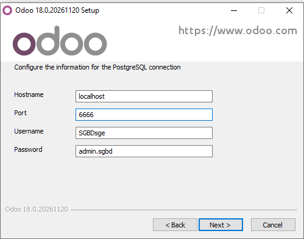

Luego hay que dejar la ruta de instalacion default:

### PASO 2

Ahora comprobamos que se ha hecho la instalacion:

### PASO 3

Accedemos a ODOO:

Comprobamos que funciona:
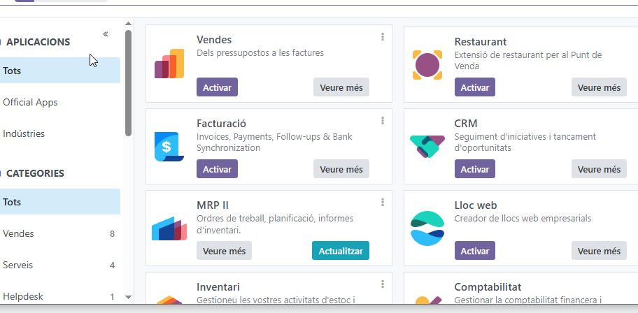

### PASO 4

Ahora vemos que se han generado las **TABLAS**:

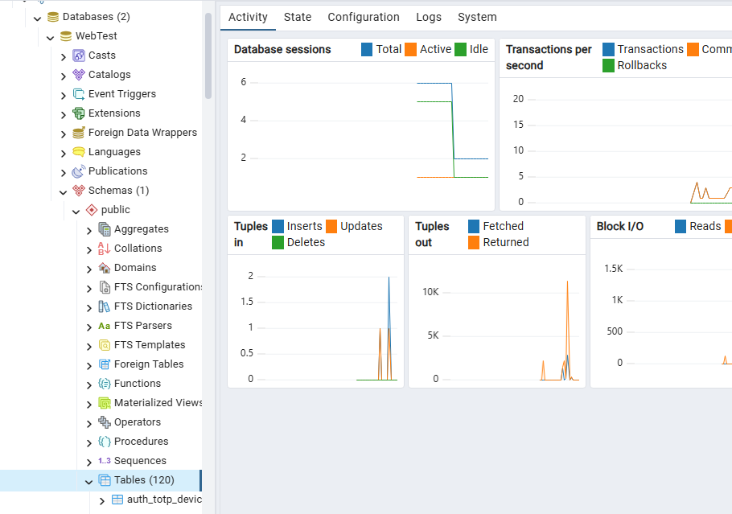

---

## P3.4. Conectar un cliente Windows 10 con Odoo

### PASO 1

Creamos una red interna y se la asignamos a las 2 maquinas:

- ADAPTADOR 1:

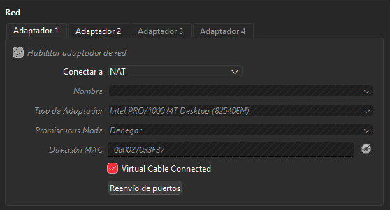

- ADAPTADOR 2
  
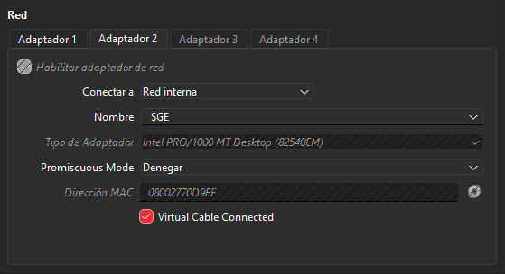

### PASO 2

Configurar la dirección IP del servidor, pulsamos `WIN + R` y buscamos `ncpa.cpl`:
- IP del server: 
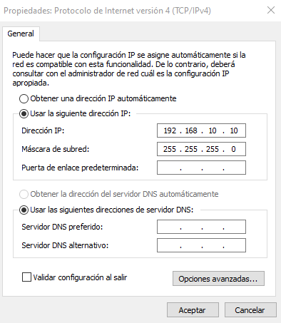

- IP del cliente: 

### PASO 3 

Comprobamos que hay conexion, pero nos dara error por culpa del firewall de Windows asi que vamos a hacer lo sigiente :

Y ahora hacemos el ping y vemos que funciona.

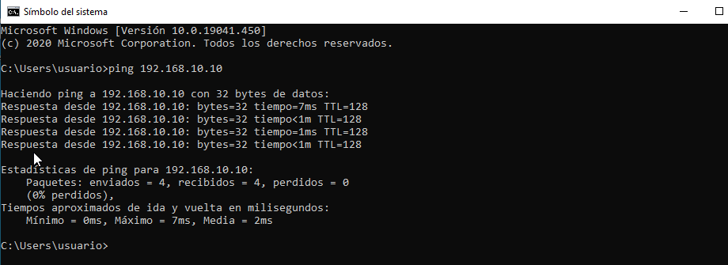

### PASO 4 

Accedemos a `ODOO` desde el cliente:

1. Primero hacemos esto en el PowerShell Servidor `(es para que el Firewall no cape el acceso al cliente)`:
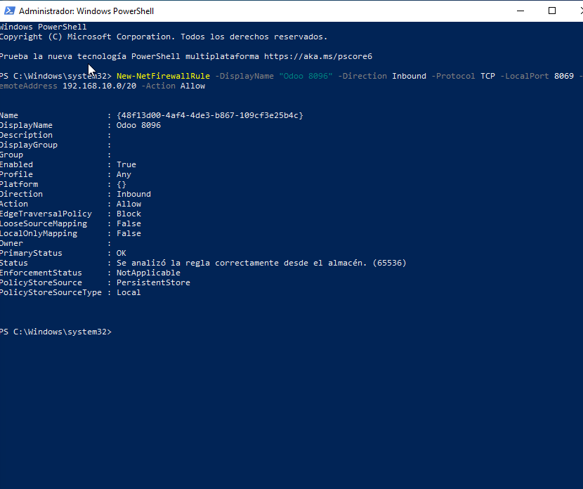

2. Probamos a entrar con el cliente:
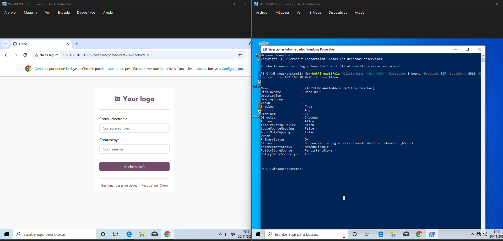

A la izquierda tenemos a el cliente y la derecha a el servidor.

3. Accedemos a Odoo con el correo y la contraseña:

Y vemos como accedemos con normalidad:
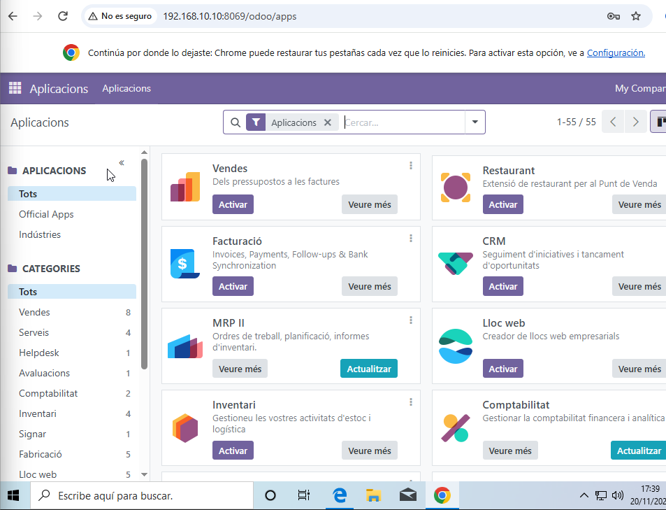

## P3.5. Cambiar la contraseña maestra y el puerto web de Odoo.

### PASO 1

1. Cambiar la configuracion de Odoo 

Asi que accedemos a la ruta de instalacion y buscamos el fichero `odoo.conf`:
- Cambiamos la clave maestra:
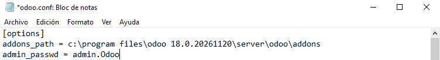

- Cambiamos esta linea para cambiar el puerto:
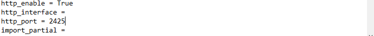

- Guardamos el archivo.

### PASO 2

1. Reiniciamos odoo:
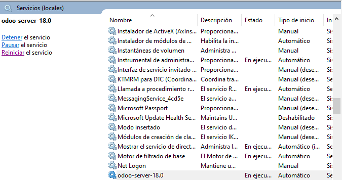

### PASO 3

1. Abrimos el navegador y comprobamos que funciona:

- Puerto antiguo:
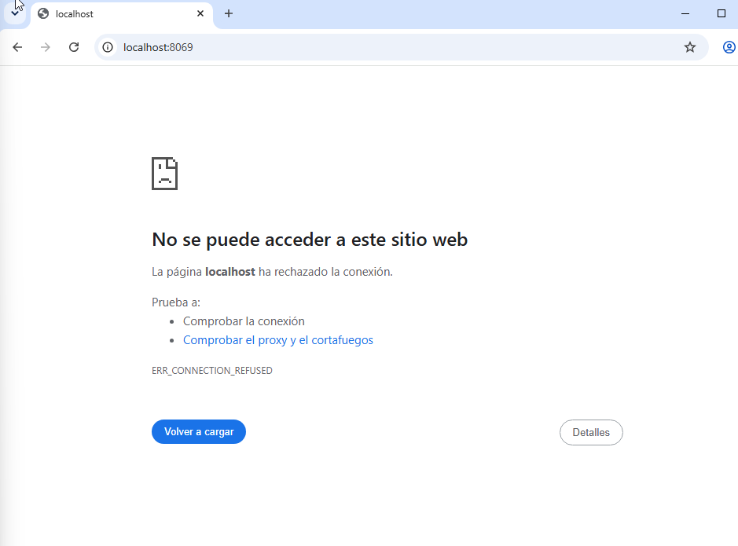

- Puerto nuevo:
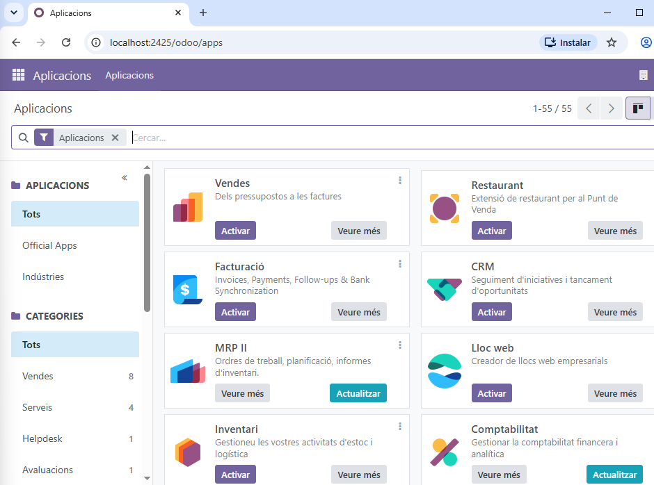

### PASO 4

1. Ahora para que se pueda acceder desde el cliente hay que hacer el comando de PowerShell de antes pero para el puerto `2425`:
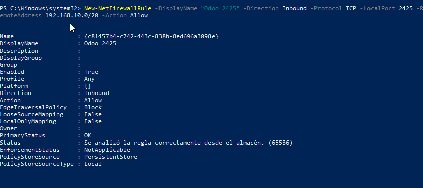

2. Comprobamos desde el navegador del cliente:
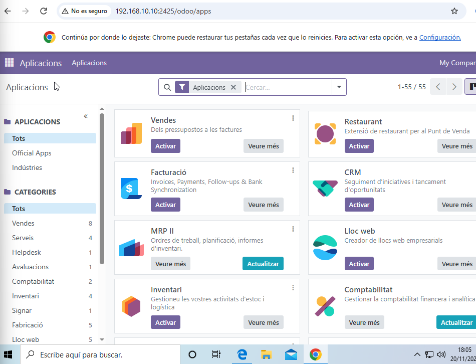

### PASO 5 

1. Comprobamos desde el cliente que se ha cambiado la clave maestra: 

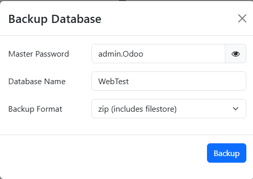

2. Y vemos que se ha hecho el zip:
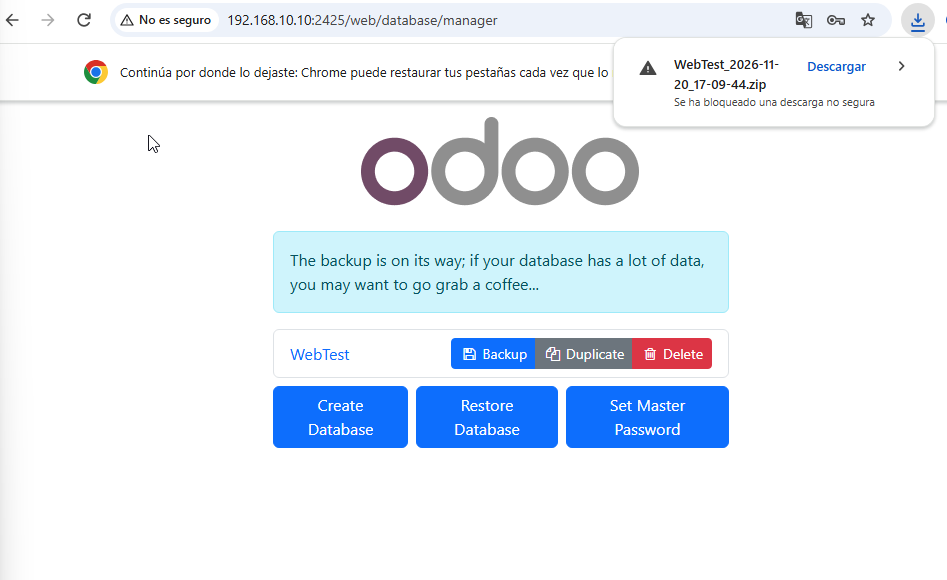

## PROBLEMAS QUE HE TENIDO

- Error en la instalacion.
**SOLUCION:** Instalar una version mas nueva, en mi caso la 18.
- Error en las IP.
**SOLUCION:** Colocar las IP's manualmente en vez de automaticamente.

- Error de carga de Odoo
**SOLUCION:** Cambiar de navegador a Crome y borrar el cache de la pagina.

