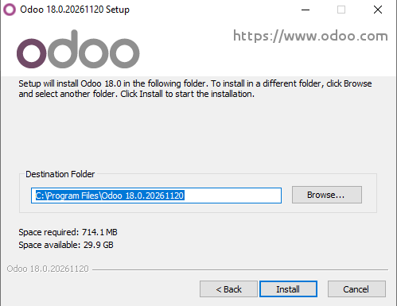
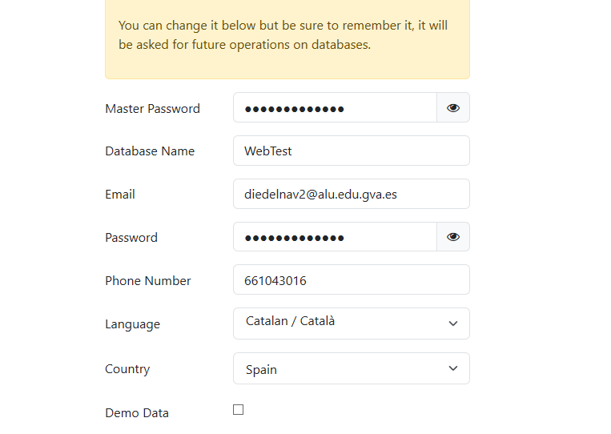
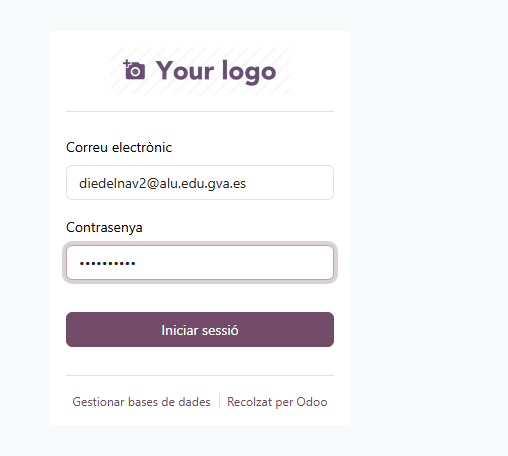
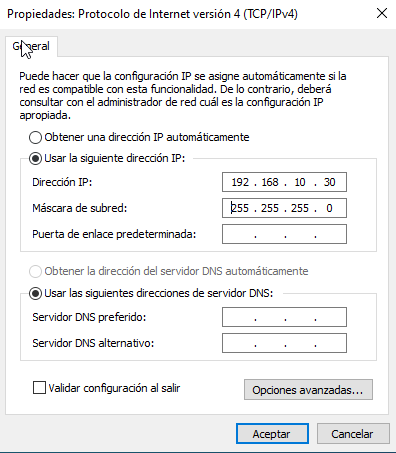
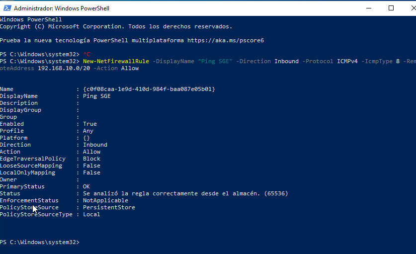

# PRACTICA U3

## P3.1. Instalar y configurar Odoo en Windows

### PASO 1

Instalamos `ODOO` y ponemos el puerto a el 6666:

Luego hay que dejar la ruta de instalacion default:

### PASO 2

Ahora comprobamos que se ha hecho la instalacion:

### PASO 3

Accedemos a ODOO:

Comprobamos que funciona:

### PASO 4

Ahora vemos que se han generado las **TABLAS**:

---

## P3.4. Conectar un cliente Windows 10 con Odoo

### PASO 1

Creamos una red interna y se la asignamos a las 2 maquinas:

- ADAPTADOR 1:

- ADAPTADOR 2
  

### PASO 2

Configurar la dirección IP del servidor, pulsamos `WIN + R` y buscamos `ncpa.cpl`:
- IP del server: 

- IP del cliente: 

### PASO 3 

Comprobamos que hay conexion, pero nos dara error por culpa del firewall de Windows asi que vamos a hacer lo sigiente :

Y ahora hacemos el ping y vemos que funciona.

### PASO 4 

Accedemos a `ODOO` desde el cliente:

